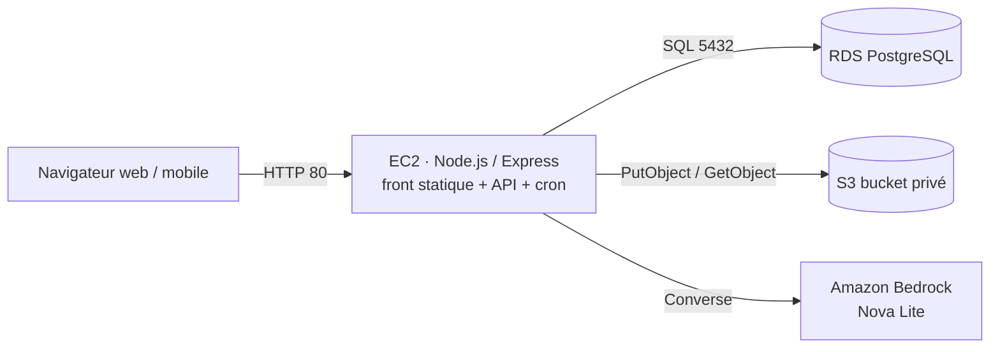

# Design Document

## Overview

Une seule application Node.js 20 / Express sur une instance EC2 (Amazon Linux 2023, port 80) sert le frontend statique (`public/`) et l'API REST (`/api`). Elle s'appuie sur RDS PostgreSQL (réseau privé), S3 (photos) et Amazon Bedrock (Nova Lite). Les droits AWS viennent du rôle IAM de l'instance.

## Architecture



- Région : `us-east-1`. Modèle : `us.amazon.nova-lite-v1:0`. Bucket : `smartcampus-photos-gx-1234`.
- Pas de Docker, pas de Traefik (HTTP direct sur le port 80 via `setcap` sur node), process géré par `pm2`.

## Data Model (`db/schema.sql`)

```sql
CREATE TABLE utilisateur (
  id SERIAL PRIMARY KEY,
  nom TEXT NOT NULL,
  email TEXT UNIQUE NOT NULL,
  mot_de_passe_hash TEXT NOT NULL,
  role TEXT NOT NULL CHECK (role IN ('etudiant','technicien','admin'))
);

CREATE TABLE lieu (
  id SERIAL PRIMARY KEY,
  batiment TEXT NOT NULL,
  salle TEXT NOT NULL,
  UNIQUE (batiment, salle)
);

CREATE TABLE categorie (
  id SERIAL PRIMARY KEY,
  libelle TEXT UNIQUE NOT NULL,          -- Salle fermée, Matériel défectueux, Problème réseau, Sécurité, Autre
  priorite_defaut TEXT NOT NULL CHECK (priorite_defaut IN ('Critique','Haute','Normale','Basse')),
  technicien_referent_id INT REFERENCES utilisateur(id)
);

CREATE TABLE ticket (
  id SERIAL PRIMARY KEY,
  numero TEXT UNIQUE NOT NULL,            -- INC-2026-00001
  description TEXT NOT NULL,
  categorie_id INT NOT NULL REFERENCES categorie(id),
  lieu_id INT NOT NULL REFERENCES lieu(id),
  auteur_id INT NOT NULL REFERENCES utilisateur(id),
  technicien_id INT REFERENCES utilisateur(id),
  statut TEXT NOT NULL DEFAULT 'Ouvert' CHECK (statut IN ('Ouvert','En cours','Résolu')),
  priorite TEXT NOT NULL CHECK (priorite IN ('Critique','Haute','Normale','Basse')),
  photo_cle TEXT,
  origine TEXT NOT NULL DEFAULT 'formulaire' CHECK (origine IN ('formulaire','assistant')),
  en_retard BOOLEAN NOT NULL DEFAULT false,
  cree_le TIMESTAMPTZ NOT NULL DEFAULT now(),
  maj_le TIMESTAMPTZ NOT NULL DEFAULT now(),
  resolu_le TIMESTAMPTZ
);
CREATE SEQUENCE ticket_numero_seq;

CREATE TABLE historique_ticket (
  id SERIAL PRIMARY KEY,
  ticket_id INT NOT NULL REFERENCES ticket(id) ON DELETE CASCADE,
  acteur_id INT NOT NULL REFERENCES utilisateur(id),
  ancien_statut TEXT,
  nouveau_statut TEXT NOT NULL,
  commentaire TEXT,
  cree_le TIMESTAMPTZ NOT NULL DEFAULT now()
);

CREATE TABLE notification (
  id SERIAL PRIMARY KEY,
  utilisateur_id INT NOT NULL REFERENCES utilisateur(id),
  ticket_id INT REFERENCES ticket(id) ON DELETE CASCADE,
  message TEXT NOT NULL,
  lue BOOLEAN NOT NULL DEFAULT false,
  cree_le TIMESTAMPTZ NOT NULL DEFAULT now()
);

CREATE TABLE faq (
  id SERIAL PRIMARY KEY,
  titre TEXT NOT NULL,
  contenu TEXT NOT NULL
);

CREATE INDEX idx_ticket_auteur ON ticket(auteur_id);
CREATE INDEX idx_ticket_tech_statut ON ticket(technicien_id, statut);
CREATE INDEX idx_ticket_cree ON ticket(cree_le);
```

### Seed (`db/seed.sql`)
- Utilisateurs : Léa Martin `lea@campus.fr` (etudiant), Karim Benali `karim@campus.fr` (technicien), Sophie Durand `sophie@campus.fr` (admin), Tom Petit `tom@campus.fr` (etudiant, pour tester RG-06). Mot de passe `demo1234` hashé avec bcrypt (générer le hash dans `db/init.js` plutôt qu'en dur).
- Lieux : bâtiments A et B, salles A12, A14, B204, B210, Amphi A, Bibliothèque.
- Catégories : Salle fermée (Normale), Matériel défectueux (Normale), Problème réseau (Haute), Sécurité (Critique), Autre (Basse) — toutes avec Karim comme référent.
- FAQ (6 fiches) : Connexion au Wi-Fi, Horaires d'ouverture, Réservation de salle, Impression, Mot de passe oublié, Objets perdus.
- ~30 tickets répartis sur les 4 derniers mois avec des statuts et dates variés, pour que le tableau de bord ait des données en démo.

## API

| Méthode et route | Rôle | Corps / paramètres | Réponse |
| --- | --- | --- | --- |
| `POST /api/auth/login` | public | `{ email, motDePasse }` | `{ token, utilisateur: { id, nom, role } }` |
| `GET /api/referentiels` | tous | — | `{ categories: [...], lieux: [...] }` |
| `POST /api/tickets` | etudiant | multipart : `categorieId, lieuId, description, origine?, photo?` | `201 { id, numero, statut }` |
| `GET /api/tickets/mes-tickets` | etudiant | — | liste |
| `GET /api/tickets/:id` | auteur, technicien assigné, admin | — | ticket + `photoUrl` présignée + `historique[]` |
| `PATCH /api/tickets/:id/statut` | technicien assigné, admin | `{ statut, commentaire? }` | ticket mis à jour |
| `GET /api/technicien/tickets` | technicien, admin | — | file triée |
| `GET /api/notifications` | tous | — | `{ nonLues, items[] }` |
| `POST /api/notifications/:id/lue` | propriétaire | — | `204` |
| `POST /api/chat` | etudiant | `{ question, historique: [{role, texte}] }` | voir format ci-dessous |
| `GET /api/stats?periode=semaine\|mois\|semestre` | admin | — | `{ parCategorie, parLieu, parStatut, delaiMoyenHeures, total }` |

Tri de la file : `ORDER BY CASE priorite WHEN 'Critique' THEN 1 WHEN 'Haute' THEN 2 WHEN 'Normale' THEN 3 ELSE 4 END, cree_le ASC`.

## Assistant IA (`src/services/bedrockService.js`)

- Client : `BedrockRuntimeClient({ region: process.env.AWS_REGION })`, commande `ConverseCommand` avec `modelId: process.env.BEDROCK_MODEL_ID`, `inferenceConfig: { maxTokens: 500, temperature: 0.2 }`.
- Prompt système (construit à chaque appel avec les fiches de la table `faq`) :

```
Tu es l'assistant du campus SmartCampus. Réponds en français, en 3 phrases maximum, uniquement à partir des fiches FAQ ci-dessous.
Si aucune fiche ne permet de répondre, dis "Je ne sais pas" et propose de créer un signalement.
Si l'utilisateur décrit un problème matériel, une salle fermée, un problème réseau ou de sécurité, considère que c'est un incident.
Réponds UNIQUEMENT avec un objet JSON valide, sans texte autour :
{"reponse": "...", "source": "<titre de la fiche ou null>", "incidentDetecte": true|false,
 "categorie": "<Salle fermée|Matériel défectueux|Problème réseau|Sécurité|Autre|null>", "lieu": "<salle citée ou null>"}

FICHES FAQ :
[1] <titre> : <contenu>
...
```

- Parsing : extraire le premier objet `{...}` du texte, `JSON.parse` dans un try/catch ; en cas d'échec, renvoyer `{ reponse: <texte brut>, source: null, incidentDetecte: false }`.
- Réponse de `/api/chat` : `{ reponse, source, incidentDetecte, proposerSignalement, prefill: { description, categorieId, lieuId } }` où `proposerSignalement = incidentDetecte || source === null`, et `categorieId` / `lieuId` sont retrouvés par correspondance (insensible à la casse) dans les référentiels, sinon `null`.
- Les tests mockent le client Bedrock (aucun appel réel en test).

## Photos (`src/services/s3Service.js`)
- `multer.memoryStorage()`, `limits: { fileSize: 5 * 1024 * 1024 }`, `fileFilter` sur `image/jpeg` et `image/png`.
- Clé : `photos/<numero>-<timestamp>.<ext>`, `PutObjectCommand` avec `ContentType`.
- Lecture : `getSignedUrl(GetObjectCommand, { expiresIn: 900 })`.

## Relance (`src/services/relanceJob.js`)
- `cron.schedule('0 * * * *', ...)` démarré dans `server.js` (pas dans `app.js`, pour ne pas tourner pendant les tests).
- Requête : tickets `statut = 'Ouvert' AND en_retard = false AND cree_le < now() - interval '24 hours'` → `en_retard = true` + notification à l'auteur. Exposer aussi la fonction `relancer()` pour la tester et la déclencher en démo.

## Frontend
- Pages statiques dans `public/` (voir structure.md), CSS mobile first, palette sobre, une barre de navigation selon le rôle.
- `public/js/api.js` : `apiFetch(url, options)` ajoute `Authorization`, parse le JSON, redirige vers `index.html` sur 401, lève une erreur avec le message serveur sinon.
- Jeton et utilisateur stockés dans `sessionStorage`.
- `signaler.html` lit `?description=&categorieId=&lieuId=` pour le pré-remplissage (US-05).
- `dashboard.html` : 3 graphiques Chart.js (barres par catégorie, barres horizontales top 5 lieux, anneau par statut) + une tuile « délai moyen de résolution ».

## Error Handling
- Erreurs métier : `throw { status, message }` dans les services, un middleware d'erreur Express renvoie `{ error: message }` avec le statut.
- Erreurs multer (taille / type) → 400 avec message en français.
- Erreur Bedrock → 503 `{ error: "L'assistant est momentanément indisponible." }`.

## Testing Strategy
- `node --test` + `supertest` sur `app` (sans démarrer le serveur ni le cron).
- Base de test : la même base RDS, tests idempotents (création de données préfixées puis nettoyage), ou mock du module `db`.
- Cas minimum : création OK / champ manquant (US-01), RG-06 (403), tri de la file et commentaire obligatoire (US-03), transition interdite (RG-09), chat hors périmètre → « Je ne sais pas » (Bedrock mocké), stats 403 pour un étudiant et calcul du délai moyen (US-06).

## Déploiement
1. Code poussé sur GitHub (sans `.env`).
2. Sur l'EC2 : `cd /opt/smartcampus && git clone <repo> app && cd app && cp ../.env .env && npm ci && npm run db:init`.
3. `pm2 delete test; pm2 start src/server.js --name smartcampus && pm2 save`.
4. Vérifier `http://<IP publique>`.
